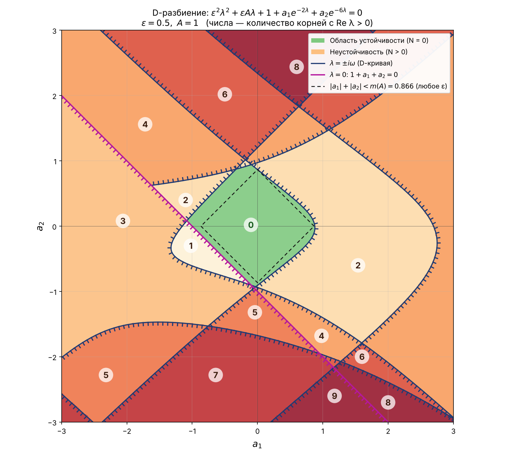

# D-разбиение 📈

## О чём?

Рассматривается характеристическое уравнение (вариант **17**):

```math
P(\lambda) = \varepsilon^2\lambda^2 + \varepsilon A\lambda + 1 + a_1 e^{-2\lambda} + a_2 e^{-6\lambda} = 0,
\qquad 0 \le \varepsilon \le 1.
```

Программа строит **D-разбиение** плоскости параметров $`(a_1, a_2)`$ при фиксированных $`\varepsilon`$ и $`A`$:

* находит границы разбиения — прямую $`\lambda = 0`$ и D-кривую $`\lambda = \pm i\omega`$;
* наносит на кривые штриховку (в какую сторону корни уходят в правую полуплоскость);
* для каждой точки плоскости считает число корней $`N`$ с $`\mathrm{Re}\,\lambda > 0`$ (принцип аргумента)
  и подписывает его в каждой области;
* выделяет **область устойчивости** ($`N = 0`$) и гарантированный ромб устойчивости $`|a_1| + |a_2| < m(A)`$;
* показывает, как меняется область устойчивости при $`\varepsilon \in \{1;\ 0.5;\ 0.25;\ 0.1;\ 0.05;\ 0\}`$;
* находит значения $`\varepsilon`$, при которых три ветви D-кривой проходят через одну точку границы устойчивости
  (тройная бифуркация Андронова–Хопфа): основная — $`\varepsilon^* \approx 0.4407427`$.

Подробный вывод всех формул и разбор результатов — в 📎 [**отчёте**](REPORT.md).



## Структура 📁

* **python/src/main/const.py** — параметры: $`\varepsilon`$, $`A`$, окно на плоскости, размер сетки, шаги по $`\omega`$.
* **python/src/main/equation.py** — квазиполином, формулы D-кривой и ромба устойчивости.
* **python/src/main/partition.py** — ветви D-кривой, штриховка, подсчёт корней, предельный случай $`\varepsilon = 0`$.
* **python/src/main/draw.py** — отрисовка графиков (matplotlib).
* **python/src/main/main.py** — точка входа: печатает расчёты и показывает/сохраняет графики.
* **python/src/main/triple.py** — поиск, уточнение и проверка тройных точек D-кривой.
* **results** — готовые картинки.

## Запуск 🚀

```shell
# Параметры по умолчанию (ε = 0.5, A = 1);
python python/src/main/main.py;

# Свои значения ε ∈ [0.01, 1] и A;
python python/src/main/main.py 1 1;

# Тройные точки D-кривой (A = 1): уточнение, проверка и картинка results/triple_point.png;
python python/src/main/triple.py;
```

Картинки сохраняются в папку **results**, а также открываются в отдельном окне.
Окно на плоскости, размер сетки и список $`\varepsilon`$ для сравнительного графика меняются в **const.py**.

## Нормальная форма Хопфа для одной пары 📈

Отдельная программа [**hopf.py**](python/src/main/hopf.py) продолжает расчёт варианта 17 в окрестности
регулярной точки D-кривой. Линейная часть и запаздывания взяты из **equation.py** и **const.py**.
Кубическая часть выбрана по примеру из лекции 19.11.2026. Знак справа входит в постановку:

```math
\varepsilon^2 x''(t)+\varepsilon A x'(t)+x(t)+a_1x(t-2)+a_2x(t-6)
=x^3(t)+x^3(t-2)+x^3(t-6).
```

### Запуск из папки DPartition

```shell
# По умолчанию: ε = 0.5, A = 1, ω = 1.2, μ = 0.001
python python/src/main/hopf.py

# Другая частота из таблицы D-кривой и сдвиг в сторону μ < 0
python python/src/main/hopf.py 0.5 1 1.0 -0.001
```

Частота ω задаёт критическую точку $(a_1^*,a_2^*)$ через **d_curve**. Параметр μ — малое расстояние
от неё по единичной нормали **n** в сторону роста Re λ: $(a_1,a_2)=(a_1^*,a_2^*)+\mu\mathbf n$.
В окне Matplotlib можно изменить **ω** и **μ** и нажать **«Вычислить коэффициенты»**.
Слева показана ветвь амплитуд, справа — два периода ведущей гармоники при выбранном μ.
Если малого цикла на этой стороне нет, программа сообщает об этом. В консоль выводятся коэффициенты,
а рисунок каждого расчёта сохраняется в **results/hopf_eps=…_A=…_w=…_mu=….png**.

### Что именно считается

При нормировке $x=z+\bar z+\cdots$ обозначим $E_1=e^{-2i\omega}$, $E_2=e^{-6i\omega}$.
Коэффициент третьей гармоники и резонансный коэффициент равны

```math
h_{30}(0)=\frac{1+E_1^3+E_2^3}{P(3i\omega)},\qquad
d_{21}=\frac{3(1+E_1+E_2)}{P'(i\omega)}.
```

Из $\partial\lambda/\partial a_j=-E_j/P'(i\omega)$ программа находит нормаль **n** и производную
$k=\partial\lambda/\partial\mu$ вдоль неё. В кубической нормальной форме
$\dot z=(i\omega+k\mu)z+d_{21}z|z|^2$ ненулевой цикл существует при
$r^2=-\mu\operatorname{Re}k/\operatorname{Re}d_{21}>0$. Тогда амплитуда исходной переменной
приблизительно равна $2r$, а угловая частота — $\omega+\mu\operatorname{Im}k+r^2\operatorname{Im}d_{21}$.
Это локальное приближение при малых $|\mu|$.

**Пример.** При запуске по умолчанию $(a_1^*,a_2^*)\approx(0.876319249,\ 0.010178834)$,
$d_{21}\approx-0.54200386-1.94519810i$. Других корней справа нет. При $\mu=0.001$
получается сверхкритическая бифуркация с устойчивым малым циклом: амплитуда $x$ около **0.05418**,
период около **5.24208**. При $\omega=1.0$ знак меняется: малый цикл существует при $\mu<0$ и неустойчив.

**Границы применимости.** Используется тот же диапазон ε, что в **main.py**. При $\sin(4\omega)\approx0$
параметризация D-кривой по одной частоте вырождается. Программа проверяет простоту выбранного корня и
по принципу аргумента считает остальные неустойчивые корни у $P(\lambda)/(\lambda^2+\omega^2)$.
Если численно нельзя отделить ещё один корень от мнимой оси (в том числе в двойной или тройной точке)
или $\operatorname{Re}d_{21}$ практически равна нулю, программа сообщает, почему классификация невозможна.
