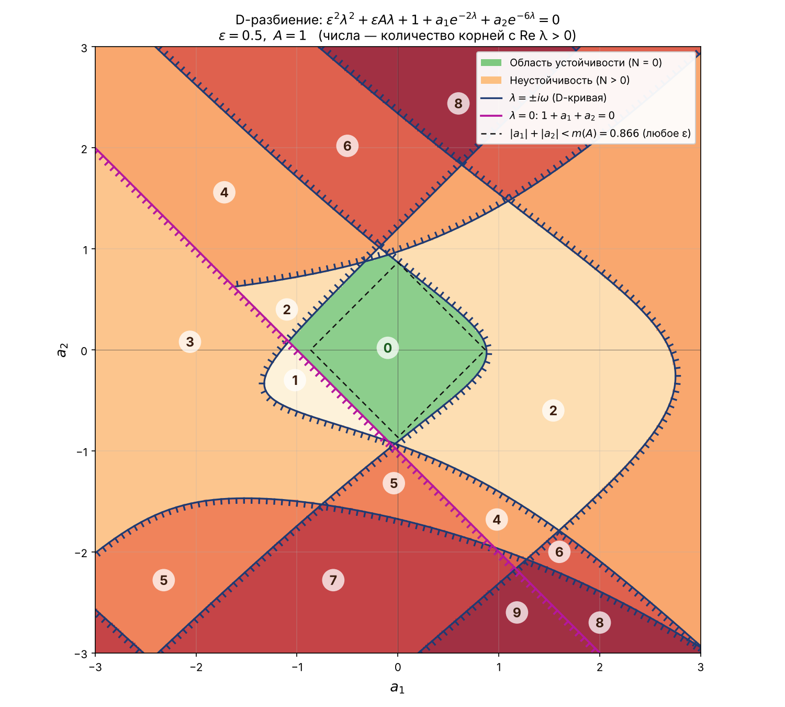

# D-разбиение 📈

## О чём?

Рассматривается характеристическое уравнение (вариант **17**):

$$
P(\lambda) = \varepsilon^2\lambda^2 + \varepsilon A\lambda + 1 + a_1 e^{-2\lambda} + a_2 e^{-6\lambda} = 0,
\qquad 0 \le \varepsilon \le 1.
$$

Программа строит **D-разбиение** плоскости параметров $(a_1, a_2)$ при фиксированных $\varepsilon$ и $A$:

* находит границы разбиения — прямую $\lambda = 0$ и D-кривую $\lambda = \pm i\omega$;
* наносит на кривые штриховку (в какую сторону корни уходят в правую полуплоскость);
* для каждой точки плоскости считает число корней $N$ с $\mathrm{Re}\,\lambda > 0$ (принцип аргумента)
  и подписывает его в каждой области;
* выделяет **область устойчивости** ($N = 0$) и гарантированный ромб устойчивости $|a_1| + |a_2| < m(A)$;
* показывает, как меняется область устойчивости при $\varepsilon \in \{1;\ 0.5;\ 0.25;\ 0.1;\ 0.05;\ 0\}$.

Подробный вывод всех формул и разбор результатов — в 📎 [**отчёте**](REPORT.md).



## Структура 📁

* **python/src/main/const.py** — параметры: $\varepsilon$, $A$, окно на плоскости, размер сетки, шаги по $\omega$.
* **python/src/main/equation.py** — квазиполином, формулы D-кривой и ромба устойчивости.
* **python/src/main/partition.py** — ветви D-кривой, штриховка, подсчёт корней, предельный случай $\varepsilon = 0$.
* **python/src/main/draw.py** — отрисовка графиков (matplotlib).
* **python/src/main/main.py** — точка входа: печатает расчёты и показывает/сохраняет графики.
* **results** — готовые картинки.

## Запуск 🚀

```shell
# Параметры по умолчанию (ε = 0.5, A = 1);
python python/src/main/main.py;

# Свои значения ε ∈ (0, 1] и A;
python python/src/main/main.py 1 1;
```

Картинки сохраняются в папку **results**, а также открываются в отдельном окне.
Окно на плоскости, размер сетки и список $\varepsilon$ для сравнительного графика меняются в **const.py**.
