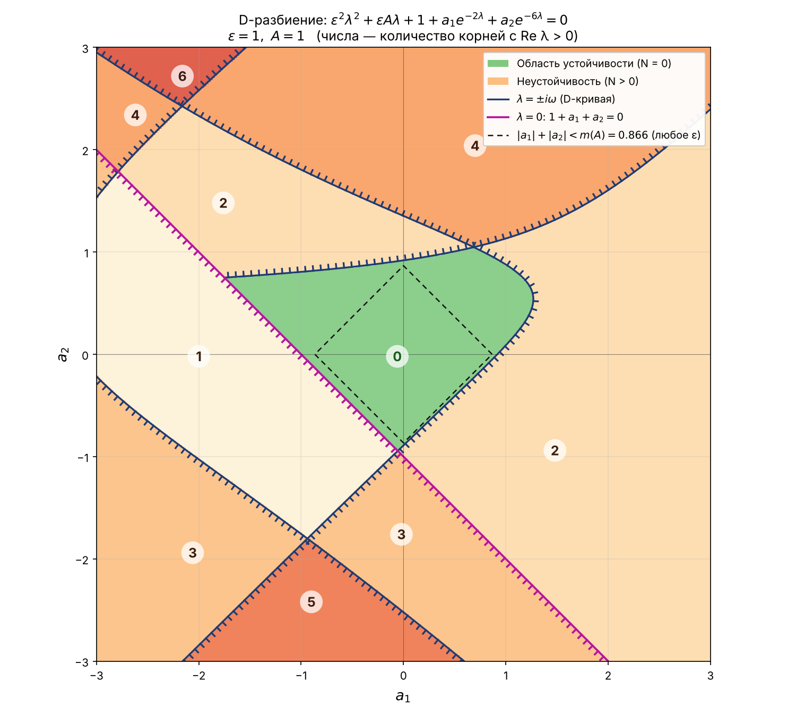
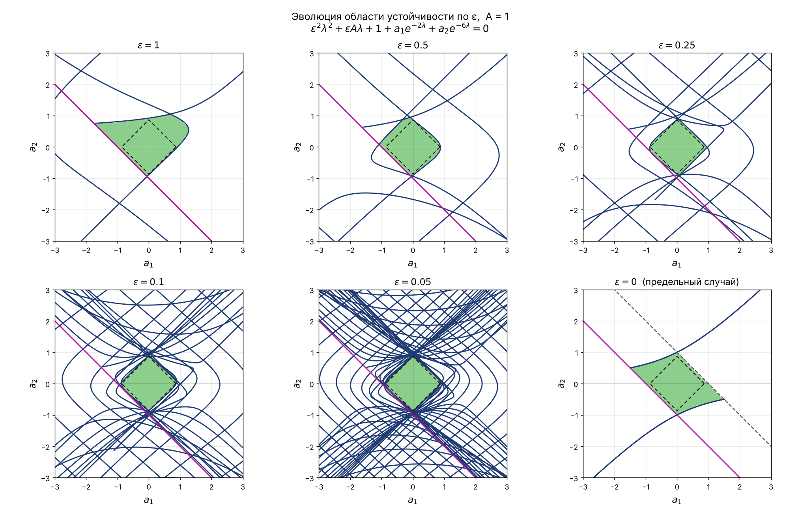

# Отчёт: D-разбиение для характеристического уравнения (вариант 17) 📝

## 1. Постановка задачи

Рассматривается характеристический квазиполином

$$
P(\lambda) = \varepsilon^2\lambda^2 + \varepsilon A\lambda + 1 + a_1 e^{-2\lambda} + a_2 e^{-6\lambda},
\qquad 0 \le \varepsilon \le 1.
$$

Запись $e^{-\lambda 2}$, $e^{-\lambda 6}$ из условия понимаем как $e^{-2\lambda}$, $e^{-6\lambda}$, т.е. запаздывания
$\tau_1 = 2$, $\tau_2 = 6$ (как и в соседних вариантах: $e^{-\lambda}$, $e^{-\lambda 3}$ и т.д.).

Такой квазиполином возникает, например, у линейного уравнения

$$
\varepsilon^2 \ddot x + \varepsilon A \dot x + x + a_1 x(t - 2) + a_2 x(t - 6) = 0
$$

при подстановке $x = e^{\lambda t}$. Нулевое решение асимптотически устойчиво, если **все** корни $P(\lambda)$
лежат в левой полуплоскости $\mathrm{Re}\,\lambda < 0$.

**Цель:** при фиксированных $\varepsilon$ и $A$ разбить плоскость параметров $(a_1, a_2)$ на области с одинаковым
числом $N$ корней в правой полуплоскости (D-разбиение) и найти область устойчивости $N = 0$.

По умолчанию берём $A = 1$ и $\varepsilon = 0.5$; дополнительно разбираем $\varepsilon = 1$ и поведение при
$\varepsilon \to 0$. Все параметры меняются в `const.py` или аргументами командной строки.

## 2. Идея метода D-разбиения

1. При $\varepsilon > 0$ старший член $\varepsilon^2\lambda^2$ не содержит запаздывания — квазиполином
   **запаздывающего типа**. У него в любой правой полуплоскости $\mathrm{Re}\,\lambda \ge -c$ лишь конечное число
   корней, и корни не могут «прийти из бесконечности» в правую полуплоскость.
2. Корни непрерывно зависят от $(a_1, a_2)$. Значит, число $N$ корней с $\mathrm{Re}\,\lambda > 0$ может
   измениться только тогда, когда какой-то корень **пересекает мнимую ось**.
3. Поэтому границы областей D-разбиения — это множества параметров, при которых $P$ имеет корень
   $\lambda = 0$ или $\lambda = \pm i\omega$, $\omega > 0$.
4. Внутри каждой области $N$ постоянно; достаточно знать $N$ в одной точке и правило изменения $N$ при переходе
   через границу (штриховку).

## 3. Граница $\lambda = 0$

$$
P(0) = 1 + a_1 + a_2 = 0 \quad\Longleftrightarrow\quad a_2 = -1 - a_1.
$$

Это прямая. При $1 + a_1 + a_2 < 0$ имеем $P(0) < 0$, а $P(\lambda) \to +\infty$ при $\lambda \to +\infty$, поэтому
у $P$ появляется положительный вещественный корень. Переход через прямую в сторону $1 + a_1 + a_2 < 0$
**увеличивает $N$ на 1** — эту сторону и штрихуем.

## 4. Граница $\lambda = i\omega$ (D-кривая)

Подставим $\lambda = i\omega$, $\omega > 0$ (корни вещественного квазиполинома сопряжены, так что $\omega < 0$
даёт ту же кривую):

$$
-\varepsilon^2\omega^2 + i\varepsilon A\omega + 1 + a_1(\cos 2\omega - i\sin 2\omega) + a_2(\cos 6\omega - i \sin 6\omega) = 0.
$$

Отделяя вещественную и мнимую части, получаем **линейную** по $(a_1, a_2)$ систему:

$$
\begin{cases}
a_1\cos 2\omega + a_2\cos 6\omega = \varepsilon^2\omega^2 - 1 =: R(\omega),\\[2pt]
a_1\sin 2\omega + a_2\sin 6\omega = \varepsilon A\omega =: I(\omega).
\end{cases}
$$

Её определитель

$$
\Delta(\omega) = \cos 2\omega \sin 6\omega - \sin 2\omega \cos 6\omega = \sin 4\omega .
$$

По правилу Крамера при $\sin 4\omega \ne 0$:

$$
\boxed{\;
a_1(\omega) = \frac{R\sin 6\omega - I\cos 6\omega}{\sin 4\omega},\qquad
a_2(\omega) = \frac{I\cos 2\omega - R\sin 2\omega}{\sin 4\omega}
\;}
$$

Это параметрическое уравнение D-кривой (функция `d_curve` в `equation.py`).

### 4.1. Ветви и особые точки

В точках $\omega_k = k\pi/4$ определитель $\sin 4\omega$ обращается в ноль, и кривая уходит на бесконечность.
Поэтому D-кривая состоит из ветвей на интервалах $\left(\tfrac{k\pi}{4}, \tfrac{(k+1)\pi}{4}\right)$
(функция `d_curve_branches`).

Если в особой точке система **совместна**, она задаёт целую прямую (особую прямую D-разбиения):

* $k = 2m$, $\omega = \pi m/2$: $\sin 2\omega = \sin 6\omega = 0$, и второе уравнение даёт $\varepsilon A\omega = 0$ —
  при $\varepsilon A \neq 0$ невозможно;
* $k = 2m+1$, $\omega = \pi(2m+1)/4$: $\cos 2\omega = \cos 6\omega = 0$, и первое уравнение даёт
  $\varepsilon^2\omega^2 = 1$, т.е. $\varepsilon = \dfrac{4}{\pi(2m+1)}$. На отрезке $[0, 1]$ это
  $\varepsilon \approx 0.4244;\ 0.2546;\ 0.1819;\ \dots$ — только при этих исключительных значениях
  появляется особая прямая $a_1\sin 2\omega + a_2 \sin 6\omega = \varepsilon A \omega$.

При $\varepsilon = 0$ первый случай выполняется всегда, и появляется особая прямая $a_1 + a_2 = 1$
(корень $\lambda = i\pi/2$). Всё это проверяется автоматически в функции `singular_lines`.

### 4.2. Сколько $\omega$ нужно перебрать

Из системы $|R + iI| = |a_1 e^{-2i\omega} + a_2 e^{-6i\omega}| \le |a_1| + |a_2|$. В окне $|a_1|, |a_2| \le 3$
имеем $|a_1| + |a_2| \le L = 6$, а $|R| = \varepsilon^2\omega^2 - 1 > L$ при $\omega > \sqrt{1 + L}/\varepsilon$.
Значит, при больших $\omega$ точек кривой в окне нет, и достаточно $\omega \in (0, \sqrt{1+L}/\varepsilon + 1]$
(функция `omega_max`). При $\varepsilon = 0.5$ это $\omega \le 6.29$ — **9 ветвей** кривой.

## 5. Штриховка: куда уходят корни

Пусть при $a = (a_1, a_2)$ у $P$ есть простой корень $\lambda = i\omega$. Продифференцируем тождество
$P(\lambda(a), a) = 0$:

$$
P'(\lambda)\,d\lambda + e^{-2\lambda}da_1 + e^{-6\lambda}da_2 = 0
\;\Rightarrow\;
d\lambda = -\frac{e^{-2i\omega}da_1 + e^{-6i\omega}da_2}{P'(i\omega)},
$$

$$
P'(\lambda) = 2\varepsilon^2\lambda + \varepsilon A - 2a_1e^{-2\lambda} - 6a_2e^{-6\lambda}.
$$

Тогда $\mathrm{Re}\,d\lambda = g_1\,da_1 + g_2\,da_2$, где

$$
g_1 = \mathrm{Re}\left(-\frac{e^{-2i\omega}}{P'(i\omega)}\right),\qquad
g_2 = \mathrm{Re}\left(-\frac{e^{-6i\omega}}{P'(i\omega)}\right).
$$

Сдвиг в направлении вектора $g$ переводит корень в правую полуплоскость. Сравнивая $g$ с левой нормалью
$(-\dot a_2, \dot a_1)$ к кривой (движемся в сторону роста $\omega$), определяем, слева или справа штриховать ветвь
(функции `crossing_direction` и `hatch_side`). Переход через D-кривую на заштрихованную сторону **увеличивает
$N$ на 2** (уходит пара $\pm i\omega$). Это классическое правило Неймарка, только знак вычисляется не по
определителю вручную, а прямо по производной корня.

## 6. Подсчёт числа корней $N$ в каждой точке

Чтобы подписать каждую область (а не только найти одну устойчивую), считаем $N$ на сетке $301 \times 301$
по **принципу аргумента** (функция `count_unstable_roots`).

Для квазиполинома запаздывающего типа со старшим членом степени $n$ без корней на мнимой оси

$$
\Delta_{\omega: 0 \to +\infty} \arg P(i\omega) = \pi\left(\frac n2 - N\right).
$$

У нас $n = 2$, поэтому

$$
\boxed{\;N = 1 - \frac{1}{\pi}\,\Delta_{0}^{+\infty}\arg P(i\omega)\;}
$$

Проверка: при $a_1 = a_2 = 0$ получаем $1 - \varepsilon^2\omega^2 + i\varepsilon A\omega$, аргумент растёт от $0$ до
$\pi$, $N = 0$ — квадратный трёхчлен устойчив при $A > 0$.

Как считается бесконечный «хвост». При $\omega > \Omega = \sqrt{1 + L}/\varepsilon$

$$
\mathrm{Re}\,P(i\omega) \le 1 - \varepsilon^2\omega^2 + |a_1| + |a_2| < 0,
$$

т.е. $P(i\omega)$ остаётся в левой полуплоскости, а $\arg P(i\omega) \to \pi$. Значит, приращение на
$[\Omega, +\infty)$ равно повороту от $\arg P(i\Omega)$ до ближайшего $\pi$ — это добавляется аналитически.
На $[0, \Omega]$ аргумент суммируется по малым шагам $\Delta\omega = 0.02$ (за шаг самый быстрый множитель
$e^{-6i\omega}$ поворачивается лишь на $0.12$ рад).

**Независимые проверки:**

* в нескольких точках $N$ пересчитан контурным интегралом $\frac{1}{2\pi}\oint d\arg P$ по границе полукруга
  радиуса 40 в правой полуплоскости — значения совпали ($0, 0, 3, 4, 0, 2$ в точках $(0,0)$, $(0.5,0.3)$,
  $(-2,0)$, $(2,2)$, $(-0.5,-0.2)$, $(1.5,-1)$ при $\varepsilon = 0.5$);
* $N$, найденное численно, везде согласуется со штриховкой: через D-кривую оно меняется на 2, через прямую
  $\lambda = 0$ — на 1 (см. графики);
* при уменьшении шага $\Delta\omega$ в 4 раза результаты практически не меняются (отличаются лишь единичные узлы сетки у самых границ).

## 7. Результаты

### 7.1. $\varepsilon = 0.5$, $A = 1$

| $N$ | 0 | 1 | 2 | 3 | 4 | 5 | 6 | 7 | 8 | 9 |
|---|---|---|---|---|---|---|---|---|---|---|
| доля окна $[-3,3]^2$ | 5.8% | 1.2% | 15.5% | 15.4% | 25.2% | 6.8% | 12.8% | 9.2% | 6.1% | 2.1% |

* Область устойчивости — криволинейный «ромб» площадью $\approx 2.09$:
  $a_1 \in [-1.08;\ 0.86]$, $a_2 \in [-0.92;\ 0.94]$.
* Слева-снизу она ограничена прямой $1 + a_1 + a_2 = 0$ (там рождается вещественный положительный корень,
  область $N = 1$), с остальных сторон — ветвями D-кривой (рождается пара комплексных корней, $N = 2$).
* На осях: $a_1 \in [-1;\ 0.878]$ при $a_2 = 0$ и $a_2 \in [-0.909;\ 0.868]$ при $a_1 = 0$.

### 7.2. $\varepsilon = 1$, $A = 1$

* Область устойчивости больше (доля окна $8.8\%$, площадь $\approx 3.19$):
  $a_1 \in [-1.74;\ 1.26]$, $a_2 \in [-0.94;\ 1.04]$.
* Всего в окне встречаются $N = 0, \dots, 6$ — при большом $\varepsilon$ кривых меньше, разбиение проще.

### 7.3. Гарантированный ромб устойчивости (для всех $\varepsilon > 0$)

Положим $x = \varepsilon\omega$. Тогда при $\lambda = i\omega$

$$
|\varepsilon^2\lambda^2 + \varepsilon A\lambda + 1| = |1 - x^2 + iAx| \ge m(A) := \min_{x \ge 0}|1 - x^2 + iAx|,
\qquad
|a_1e^{-2i\omega} + a_2 e^{-6i\omega}| \le |a_1| + |a_2|.
$$

Значит, при $|a_1| + |a_2| < m(A)$ корней на мнимой оси нет **ни при каком** $\varepsilon > 0$ (и $P(0) \ne 0$,
так как $m(A) \le 1$). Ромб связен и содержит устойчивую точку $(0,0)$, поэтому целиком лежит в области
устойчивости. Минимизируя $f(u) = (1-u)^2 + A^2u$, $u = x^2$:

$$
m(A) =
\begin{cases}
A\sqrt{1 - A^2/4}, & 0 < A < \sqrt 2,\\
1, & A \ge \sqrt 2,
\end{cases}
\qquad m(1) = \frac{\sqrt 3}{2} \approx 0.866 .
$$

На графиках это пунктирный ромб (функция `guaranteed_radius`).

### 7.4. Что происходит при $\varepsilon \to 0$

Границы области устойчивости на осях:

| $\varepsilon$ | $a_1$ при $a_2 = 0$ | $a_2$ при $a_1 = 0$ |
|---|---|---|
| 1 | $[-1.000;\ 0.917]$ | $[-0.891;\ 0.919]$ |
| 0.5 | $[-1.000;\ 0.878]$ | $[-0.909;\ 0.868]$ |
| 0.25 | $[-0.867;\ 0.946]$ | $[-0.869;\ 0.875]$ |
| 0.1 | $[-0.879;\ 0.867]$ | $[-0.868;\ 0.868]$ |

* С уменьшением $\varepsilon$ D-кривых в окне становится всё больше (ветви идут с шагом $\pi/4$ по $\omega$,
  а $\omega$ нужно перебирать до $\sim 1/\varepsilon$), они густо заполняют плоскость, а область устойчивости
  **сжимается к ромбу** $|a_1| + |a_2| < m(A)$: вершины стремятся к $0.866$.
  Причина — на частотах $\omega = x/\varepsilon$ множители $e^{-2i\omega}$, $e^{-6i\omega}$ вращаются очень быстро
  и «пробегают» все фазы, так что оценка из п. 7.3 становится точной в вершинах.
* **Предельный случай $\varepsilon = 0$ — сингулярный.** Уравнение вырождается в разностное
  $1 + a_1e^{-2\lambda} + a_2 e^{-6\lambda} = 0$. Заменой $z = e^{-2\lambda}$ получаем $1 + a_1 z + a_2 z^3 = 0$,
  а $\mathrm{Re}\,\lambda < 0 \Leftrightarrow |z| > 1$; для $w = 1/z$: все корни $w^3 + a_1 w^2 + a_2 = 0$ должны
  лежать в круге $|w| < 1$ (условие Шура–Кона; в программе — собственные числа сопровождающей матрицы,
  функция `stable_mask_limit`). Эта область (правая нижняя панель) **не является пределом** областей при
  $\varepsilon \to 0$: например, точка $(a_1, a_2) = (1, -0.4)$ устойчива при $\varepsilon = 0$, но при
  $\varepsilon > 0$ неустойчива, причём число неустойчивых корней растёт как $1/\varepsilon$:

  | $\varepsilon$ | 1 | 0.5 | 0.25 | 0.1 | 0.05 | 0.02 |
  |---|---|---|---|---|---|---|
  | $N$ в точке $(1, -0.4)$ | 2 | 2 | 4 | 6 | 12 | 32 |

  Поэтому при малых $\varepsilon$ нельзя просто «отбросить» члены $\varepsilon^2\lambda^2 + \varepsilon A\lambda$ —
  правильной оценкой области устойчивости служит ромб $|a_1| + |a_2| < m(A)$.

## 8. Как устроена программа

| Файл | Что делает |
|---|---|
| `const.py` | $\tau_1 = 2$, $\tau_2 = 6$, значения $\varepsilon$, $A$ по умолчанию, окно, сетка, шаги по $\omega$ |
| `equation.py` | $P(\lambda)$, $P'(\lambda)$, прямая $\lambda = 0$, формулы D-кривой, направление ухода корня, $m(A)$ |
| `partition.py` | ветви D-кривой и штриховка, особые прямые, $N$ по принципу аргумента, случай $\varepsilon = 0$, поиск связных областей для подписей |
| `draw.py` | главный график D-разбиения и сравнительный график по $\varepsilon$ |
| `main.py` | печать расчётов в консоль, построение и сохранение графиков |

Алгоритм:

1. Строим ветви D-кривой $a(\omega)$ между нулями $\sin 4\omega$ и прямую $1 + a_1 + a_2 = 0$.
2. Для каждой ветви находим сторону штриховки по знаку $\mathrm{Re}\,d\lambda$.
3. На сетке считаем $N(a_1, a_2)$ по принципу аргумента (векторно, numpy).
4. Красим области по $N$ (зелёный — устойчивость, от светлого к тёмно-красному — рост $N$), ищем связные
   компоненты и подписываем $N$ в самой «глубокой» точке каждой.
5. Повторяем для набора $\varepsilon$ и сравниваем области устойчивости; для $\varepsilon = 0$ — критерий Шура–Кона.

Время работы с параметрами по умолчанию — около 10 секунд.

## 9. Выводы

* Границы D-разбиения: прямая $1 + a_1 + a_2 = 0$ и D-кривая
  $a_1 = \dfrac{(\varepsilon^2\omega^2-1)\sin 6\omega - \varepsilon A\omega\cos 6\omega}{\sin 4\omega}$,
  $a_2 = \dfrac{\varepsilon A\omega\cos 2\omega - (\varepsilon^2\omega^2-1)\sin 2\omega}{\sin 4\omega}$.
* Область устойчивости — единственная область с $N = 0$, она содержит начало координат. При $A = 1$:
  для $\varepsilon = 1$ это $a_1 \in [-1.74;\ 1.26]$, $a_2 \in [-0.94;\ 1.04]$; для $\varepsilon = 0.5$ —
  $a_1 \in [-1.08;\ 0.86]$, $a_2 \in [-0.92;\ 0.94]$.
* При любом $\varepsilon \in (0, 1]$ гарантированно устойчив ромб $|a_1| + |a_2| < m(A)$
  ($m(1) = \sqrt3/2$), и при $\varepsilon \to 0$ область устойчивости к нему сжимается.
* Предел $\varepsilon = 0$ сингулярен: область устойчивости разностного уравнения шире и не совпадает
  с пределом областей при $\varepsilon \to 0$.
